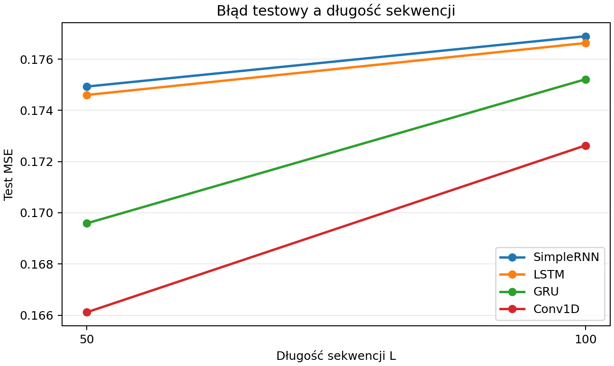

# Sprawozdanie laboratoryjne

**Przedmiot:** Uczenie głębokie w systemach rozpoznawania i przetwarzania mowy  
**Zajęcia nr / temat:** 4 — Obsługa długich sekwencji z użyciem SimpleRNN, LSTM, GRU i Conv1D  
**Autor / grupa:** Oskar Pietrzak / [uzupełnij grupę]  
**Data:** 11.11.2026

## 1. Cel ćwiczenia

Porównano SimpleRNN, LSTM, GRU i Conv1D w zadaniu sumowania dwóch wartości wskazywanych przez znaczniki opóźnione o osiem kroków. Zbadano wpływ długości sekwencji, rozmiaru stanu ukrytego SimpleRNN oraz dylatacji Conv1D na błąd testowy i czas uczenia.

## 2. Metoda i implementacja

- **Dane.** Dla każdej długości (50 i 100) wygenerowano 4096 sekwencji treningowych i 1024 niezależne sekwencje testowe. Pierwszy kanał zawiera wartości z rozkładu jednostajnego na `[0, 1]`. W drugim kanale ustawiono dwie jedynki w różnych krokach wylosowanych bez zwracania z zakresu od 9 do `L`. Każdy znacznik w kroku `t` wskazuje wartość z kroku `t − 8`. Wszystkie modele i warianty danej długości otrzymały te same zbiory.
- **Modele.** Każdy model rekurencyjny ma jedną warstwę z 32 jednostkami (64 w dodatkowym SimpleRNN) i liniowe wyjście z ostatniego stanu ukrytego. Conv1D ma trzy warstwy po 32 kanały z ReLU, jądrem długości 3 i krokiem 1. Symetryczne dopełnienie każdej warstwy jest równe jej dylatacji. Liniowe wyjście korzysta ze średnich cech w czasie.
- **Trening.** PyTorch 2.15.0+cpu, CPU AMD EPYC 9V74, dwa wątki. Ziarno 42 dla generatora NumPy, inicjalizacji modeli i tasowania partii. Dla każdego modelu użyto 30 epok, partii po 128, optymalizatora Adam z krokiem uczenia 0,003 i funkcji straty MSE. Czas obejmuje pętlę uczenia. Ustawienia ustalono przed oceną, a zbioru testowego użyto do pomiaru końcowego i analizy błędu.
- **Predykcja stała.** Dla każdej długości obliczono średnią wartości celu na zbiorze treningowym i użyto jej jako predykcji dla wszystkich sekwencji testowych.

Kod i wyniki wykonanych komórek są w [notatniku](lab4_dlugie_sekwencje.ipynb).

**Ręczna kontrola generatora.** W pierwszej sekwencji treningowej dla `L = 50` znacznik w kroku 26 wskazuje krok 18 (wartość 0,128114), a znacznik w kroku 48 wskazuje krok 40 (wartość 0,631664). Suma po zaokrągleniu wynosi 0,759778 i zgadza się z celem generatora. Kroki numerowano od 1.

## 3. Wyniki

| L | Model | Test MSE | Czas uczenia [s] | Parametry |
|---:|---|---:|---:|---:|
| 50 | Predykcja stała | 0,172694 | — | — |
| 50 | SimpleRNN | 0,174929 | 4,94 | 1185 |
| 50 | LSTM | 0,174600 | 4,44 | 4641 |
| 50 | GRU | 0,169589 | 11,34 | 3489 |
| 50 | Conv1D [1, 2, 4] | 0,166116 | 4,15 | 6465 |
| 100 | Predykcja stała | 0,176067 | — | — |
| 100 | SimpleRNN | 0,176892 | 7,71 | 1185 |
| 100 | LSTM | 0,176628 | 9,33 | 4641 |
| 100 | GRU | 0,175213 | 23,25 | 3489 |
| 100 | Conv1D [1, 2, 4] | 0,172629 | 6,10 | 6465 |
| 100 | SimpleRNN (64 jednostki) | 0,176799 | 14,59 | 4417 |
| 100 | Conv1D [1, 1, 1] | 0,172563 | 6,33 | 6465 |

## 4. Analiza i interpretacja

**Wpływ długości.** GRU i Conv1D z dylatacjami `[1, 2, 4]` uzyskały niższy MSE niż predykcja stała dla obu długości. SimpleRNN i LSTM uzyskały wyższy MSE niż predykcja stała przy obu długościach. Po przejściu z 50 do 100 kroków MSE wzrósł o 0,001963 dla SimpleRNN, 0,002028 dla LSTM, 0,005625 dla GRU i 0,006513 dla Conv1D. MSE samej predykcji stałej wzrósł o 0,003373 na niezależnie wylosowanym zbiorze. Przewaga Conv1D nad predykcją stałą zmalała z 0,006578 do 0,003437, a przewaga GRU z 0,003106 do 0,000853.

**Rozmiar stanu SimpleRNN.** Dla `L = 100` zwiększenie stanu z 32 do 64 zmniejszyło MSE o 0,000093. Liczba parametrów wzrosła z 1185 do 4417, a czas z 7,71 s do 14,59 s. Wariant 64 nadal miał wyższy MSE niż predykcja stała.

**Dylatacja Conv1D.** Przy jądrze długości 3 i kroku 1 każda warstwa zwiększa pole recepcyjne o dwukrotność swojej dylatacji. Dla `[1, 2, 4]` pole wynosi `1 + 2 × (1 + 2 + 4) = 15` kroków. Pozycja pośrodku między próbką a znacznikiem może objąć oba, ponieważ są oddalone od niej o cztery kroki. Dla `[1, 1, 1]` pole wynosi `1 + 2 × (1 + 1 + 1) = 7` kroków. Skrajne pozycje w takim oknie dzieli najwyżej sześć kroków, więc żadna pozycja mapy cech nie obejmie jednocześnie próbki i jej znacznika. Uśrednianie łączy cechy z całej sekwencji, dzięki czemu model może korzystać z informacji zbiorczej o wartościach wejściowych.

Dla `L = 100` wariant `[1, 1, 1]` osiągnął MSE niższy o 0,000066 i trenował o 0,23 s dłużej. Oba warianty miały 6465 parametrów. Ta różnica MSE w pojedynczym uruchomieniu nie pozwala stwierdzić, że usunięcie dylatacji poprawia jakość modelu. Większe pole recepcyjne daje modelowi dostęp do pary, lecz sam wynik MSE nie pokazuje, czy model wykorzystał tę możliwość.

**Przykład dużego błędu.** Największy błąd kwadratowy SimpleRNN z 32 jednostkami dla `L = 100` wystąpił w 87. sekwencji testowej. Znaczniki w krokach 56 i 57 wskazują kroki 48 i 49 o wartościach 0,960809 i 0,990470. Prawidłowa suma wynosi 1,951279, predykcja 0,959525, a błąd kwadratowy 0,983575. Odczyt nastąpił z ostatniego stanu ukrytego, 43 kroki po drugim znaczniku. Żeby odtworzyć sumę, sieć musiała zachować potrzebną informację do końca sekwencji. Predykcja bliska 1 sugeruje, że w tym przykładzie końcowy stan nie wystarczył do odtworzenia wysokiej sumy.

## 5. Wnioski

Spośród czterech konfiguracji podstawowych Conv1D uzyskał najniższy MSE i najkrótszy czas treningu dla obu długości. Poprawa względem predykcji stałej była niewielka i zmalała przy dłuższej sekwencji. Szerszy SimpleRNN zwiększył koszt treningu przy minimalnej zmianie MSE. Porównanie dylatacji pokazało różnicę w dostępnym kontekście czasowym, a wyniki z jednego ziarna nie rozstrzygają o przewadze którejkolwiek konfiguracji splotu.

---

## Kryteria oceny (rubryka)

| Element | Waga |
|---|---:|
| Poprawność implementacji | 40% |
| Wyniki i ich interpretacja | 30% |
| Czytelność kodu (PEP8, komentarze) | 20% |
| Wnioski | 10% |

Próg zaliczenia sprawozdań (O1) wynosi 90%. Termin oddania to tydzień po zajęciach.

**Prowadzący:** dr Tomasz Cieplak i mgr inż. Patryk Marek  
**Rok akademicki:** 2026/27
