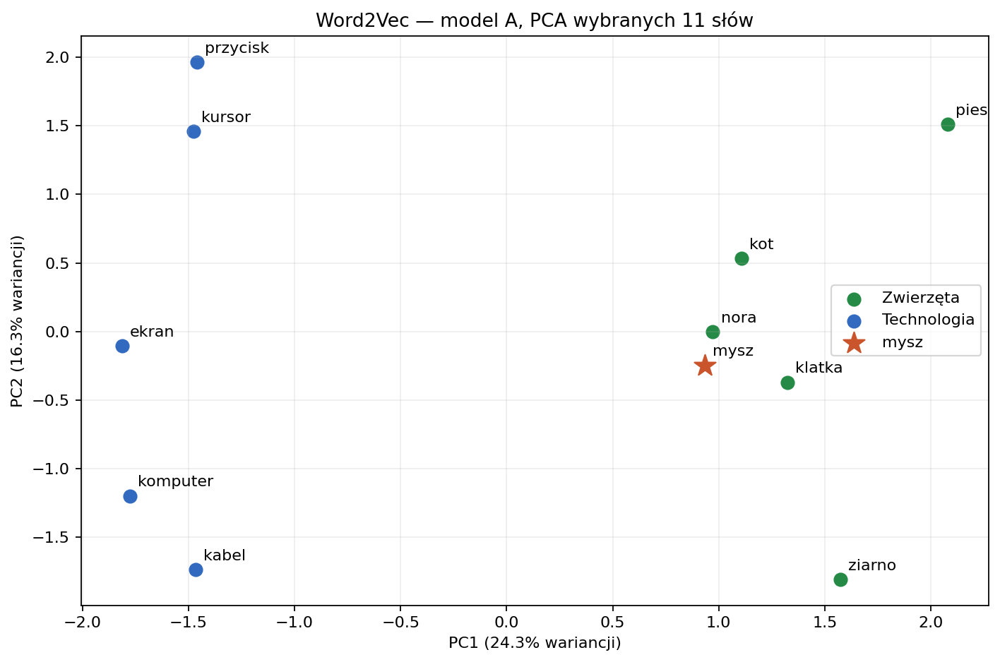

# Sprawozdanie laboratoryjne

**Przedmiot:** Uczenie głębokie w systemach rozpoznawania i przetwarzania mowy  
**Zajęcia nr / temat:** 5 — Wpływ korpusu na tokenizację BPE i embeddingi Word2Vec  
**Autor / grupa:** Oskar Pietrzak / Gl.03 
**Data:** 18.11.2026

## 1. Cel ćwiczenia

Celem było sprawdzenie wpływu rozmiaru słownika BPE na tokenizację polskich form
fleksyjnych oraz wpływu proporcji kontekstów na statyczny wektor słowa wieloznacznego.
Wybrano „mysz” w znaczeniu zwierzęcia i urządzenia komputerowego. Dodatkowo zbadano
grupy tematyczne za pomocą PCA i podobieństwa cosinusowego w pełnej przestrzeni 50D.

## 2. Metoda i implementacja

### Dane i przygotowanie tekstu

Źródłem był korpus 60 różnych zdań opracowanych na potrzeby ćwiczenia. Pełna treść
znajduje się w [wykonanym notebooku](laboratorium_05.ipynb), w sekcji 2. Korpusu nie
powielano i nie korzystano z pobieranych modeli ani zewnętrznych tekstów.

| Pula | Znaczenie / zawartość | Liczba zdań | Wystąpienia formy „mysz” |
| --- | --- | --- | --- |
| Z | Zwierzę | 20 | 20 |
| U | Urządzenie komputerowe | 20 | 20 |
| N | Zdania bez badanej formy, w tym konteksty obu tematów | 20 | 0 |

Każde zdanie z Z i U zawiera „mysz” dokładnie raz. Tekst zmieniono na małe litery,
wydzielono słowa wyrażeniem `re.findall(r'[^\W\d_]+', tekst.lower())` i pominięto
interpunkcję. Zachowano polskie znaki, odmianę i słowa funkcyjne. BPE otrzymało słowa
połączone pojedynczymi spacjami; Word2Vec — listy pełnych słów.
Obecność form sprawdzono jako przynależność całego słowa do zbioru po tej samej
normalizacji, a nie jako wystąpienie podciągu znaków.

| Forma widziana | Forma niewidziana | Obecność pierwszej | Obecność drugiej |
| --- | --- | --- | --- |
| mysz | myszami | tak | nie |
| kot | kotem | tak | nie |
| komputer | komputerami | tak | nie |
| ekran | ekranami | tak | nie |
| klatka | klatkami | tak | nie |
| kursor | kursorami | tak | nie |

### Konfiguracja BPE

**Hipoteza zapisana przed treningiem:** zwiększenie słownika powinno zmniejszać średnią
liczbę tokenów dla obu grup form. Dla form niewidzianych efekt może być słabszy,
ponieważ model nie poznał ich pełnych postaci. Granice tokenów nie muszą pokrywać
się z granicami morfemów.

Wytrenowano BPE na wszystkich 60 zdaniach, zmieniając wyłącznie `vocab_size`
(100, 200, 400). Wspólne parametry: `min_frequency=1`, token specjalny `[UNK]`,
pretokenizer `Whitespace`. Każdą z 12 form kodowano oddzielnie, po jednym razie.
Wynik jest nieważoną średnią z sześciu słów w każdej grupie. Pierwszy limit stanowi
punkt odniesienia dla większych słowników.

### Konfiguracja Word2Vec i PCA

| Wariant | Pula Z | Pula U | Wspólna pula N | Łącznie zdań | Wystąpienia „mysz” | Słowa przed min_count |
| --- | --- | --- | --- | --- | --- | --- |
| A — przewaga zwierzęcia | pierwsze 12 | pierwsze 4 | wszystkie 20 | 36 | 16 | 277 |
| B — przewaga urządzenia | pierwsze 4 | pierwsze 12 | wszystkie 20 | 36 | 16 | 276 |

W obu modelach ustawiono: Skip-gram (`sg=1`), `vector_size=50`, `window=3`,
`min_count=2`, `epochs=400`, `seed=0`, `workers=1`, `sample=0`, `negative=5`,
`alpha=0.025`, `min_alpha=0.0001`. Użyto stabilnego haszowania `crc32`.
Wyłączono subsampling, aby zachować nieliczne wystąpienia. Zmieniano konteksty
przy stałej liczbie zdań i wystąpień słowa „mysz”; pozostałe częstości i łączna
liczba słów nie były wyrównywane. Sąsiedztwo liczono cosinusem w 50D.

Przed treningiem i oglądaniem PCA wybrano dwie grupy po pięć słów:

- Zwierzęta: `kot`, `pies`, `nora`, `ziarno`, `klatka` — zwierzęta, schronienia i pokarm.
- Technologia: `komputer`, `ekran`, `kursor`, `przycisk`, `kabel` — sprzęt i elementy obsługi interfejsu.

PCA dopasowano jeden raz do 11 wektorów modelu A: obu grup i „mysz”. Nie wykonywano
osobnego rzutu dla każdej grupy. Średnie cosinusy policzono z pełnych wektorów,
bez „mysz”: po 10 nieuporządkowanych par w każdej grupie i 25 par między grupami.
Żadnej pary nie liczono dwukrotnie.

Najważniejszy schemat implementacji:

```python
scores = K @ q / np.sqrt(K.shape[1])
wagi = np.exp(scores - scores.max())
wagi /= wagi.sum()
kontekst = wagi @ K
```

Powyższy dodatkowy przykład uwagi wykorzystuje osadzenie „mysz” jako zapytanie
i wektory słów zdania jako klucze oraz wartości. Wagi sumują się do 1, a kontekst
ma 50 współrzędnych. Nie uczono projekcji Q/K/V. Pełny kod BPE, Word2Vec,
kontrole danych i wykonane komórki znajdują się w notebooku.
Użyto Pythona 3.12, `tokenizers` 0.23.3, `gensim` 4.4.0,
`scikit-learn` 1.8.0, NumPy, pandas i Matplotlib.

## 3. Wyniki

### Tokenizacja BPE

| Limit vocab_size | Faktyczny rozmiar V | Średnia: widziane | Formy z UNK: widziane | Średnia: niewidziane | Formy z UNK: niewidziane |
| --- | --- | --- | --- | --- | --- |
| 100 | 100 | 1.500 | 0 | 4.500 | 0 |
| 200 | 200 | 1.000 | 0 | 3.000 | 0 |
| 400 | 400 | 1.000 | 0 | 2.833 | 0 |

W tabeli „formy z UNK” oznacza liczbę słów zawierających przynajmniej jeden `[UNK]`,
a nie łączną liczbę nieznanych tokenów. Trzy faktyczne rozmiary słownika są różne.

Podziały dwóch form niewidzianych:

| Limit | Forma | Podział |
| --- | --- | --- |
| 100 | myszami | mysz · a · m · i |
| 100 | komputerami | kompute · ra · m · i |
| 200 | myszami | mysz · a · mi |
| 200 | komputerami | kompute · ra · mi |
| 400 | myszami | mysz · ami |
| 400 | komputerami | kompute · ra · mi |

Znak `·` oddziela tokeny. Dla „myszami” przejście 100 → 200 scala `m` i `i` w `mi`,
a przejście 200 → 400 pozwala uzyskać `ami`. Fragment `mysz` występuje we wszystkich
zdaniach Z i U; `mi` można znaleźć w treningowym „kotami” i „studentami”, a `ami`
również w „psami”. Dla „komputerami” przejście 100 → 200 daje `mi`, natomiast
przy 400 podział już się nie zmienia. `kompute` jest początkiem treningowych
„komputer” i „komputerach”, a `ra` występuje m.in. w „ekran” i „raport”.
Notebook podaje dodatkowo przykłady form treningowych dla każdego fragmentu.

Względem limitu 100 średnia dla widzianych form spadła o 33,3% (1,50 → 1,00),
a dla niewidzianych o 37,0% (4,50 → 2,83). Wykres zmian i wszystkie 36 podziałów
zapisano w notebooku.

### Sąsiedzi słowa „mysz”

| Pozycja | Sąsiad A | Cosinus A | Sąsiad B | Cosinus B |
| --- | --- | --- | --- | --- |
| 1 | jej | 0.4724 | użytkownik | 0.5435 |
| 2 | do | 0.4500 | pies | 0.5149 |
| 3 | nora | 0.4183 | łączy | 0.4562 |
| 4 | pilnuje | 0.3682 | do | 0.4505 |
| 5 | nowy | 0.3594 | wyświetla | 0.3582 |

Sprawdzenie słownika i częstości dla sumy obu pierwszych piątek:

| Słowo | Wektor w A | Wektor w B | Wystąpienia w A | Wystąpienia w B | Cosinus z mysz w A | Cosinus z mysz w B |
| --- | --- | --- | --- | --- | --- | --- |
| do | tak | tak | 2 | 2 | 0.4500 | 0.4505 |
| jej | tak | nie | 3 | 1 | 0.4724 | brak wektora |
| nora | tak | tak | 4 | 2 | 0.4183 | 0.3416 |
| nowy | tak | tak | 2 | 3 | 0.3594 | 0.2908 |
| pies | tak | tak | 7 | 5 | 0.3515 | 0.5149 |
| pilnuje | tak | tak | 2 | 2 | 0.3682 | 0.2263 |
| użytkownik | nie | tak | 0 | 3 | brak wektora | 0.5435 |
| wyświetla | tak | tak | 2 | 3 | 0.0796 | 0.3582 |
| łączy | tak | tak | 2 | 2 | 0.2136 | 0.4562 |

Dodatkowi sąsiedzi dwóch słów w modelu A:

| Zapytanie | Sąsiad | Cosinus |
| --- | --- | --- |
| kot | podczas | 0.6479 |
| kot | gniazdo | 0.5331 |
| kot | gdy | 0.5077 |
| komputer | nowy | 0.6393 |
| komputer | wyświetla | 0.5997 |
| komputer | wskazuje | 0.5513 |

### Grupy tematyczne i PCA

Liczba wystąpień z góry wybranych słów:

| Słowo | A | B |
| --- | --- | --- |
| kot | 8 | 5 |
| pies | 7 | 5 |
| nora | 4 | 2 |
| ziarno | 7 | 4 |
| klatka | 4 | 3 |
| komputer | 6 | 9 |
| ekran | 6 | 9 |
| kursor | 5 | 8 |
| przycisk | 5 | 9 |
| kabel | 4 | 6 |
| mysz | 16 | 16 |

Wszystkie słowa obu grup spełniają `min_count=2` w modelu A.



PC1 wyjaśnia 24,25%, PC2 16,32%, a łącznie **40,57%** wariancji 11 wybranych wektorów.
Kolor zielony oznacza zwierzęta, niebieski technologię, a pomarańczowa gwiazda „mysz”.

| Pary | Liczba par | Średni cosinus |
| --- | --- | --- |
| Wewnątrz zwierząt | 10 | 0.3217 |
| Wewnątrz technologii | 10 | 0.4358 |
| Między grupami | 25 | 0.1658 |

Konkretne pary porównane w przestrzeni pełnej i na rzucie:

| Słowo 1 | Słowo 2 | Cosinus 50D | Odległość PCA 2D |
| --- | --- | --- | --- |
| komputer | ekran | 0.5383 | 1.0930 |
| kot | pies | 0.4021 | 1.3768 |
| kot | komputer | 0.1548 | 3.3660 |

## 4. Analiza i interpretacja

### Wpływ rozmiaru słownika

Wyniki wspierają hipotezę na poziomie średnich. Widziane formy już przy limicie 200
są pojedynczymi tokenami; dalszy wzrost nie skraca ich reprezentacji. Formy
niewidziane pozostają podzielone, choć mogą korzystać z poznanych fragmentów.
Brak `[UNK]` wynika z pokrycia znaków w badanej próbce, a nie z gwarancji obsługi
dowolnego przyszłego tekstu.

Spadek nie dotyczy każdej formy osobno. „Kotem” ma trzy tokeny przy każdym limicie,
a „komputerami” przy 200 i 400 ma ten sam podział. Mimo obecności pełnego tokenu
„komputer” większy tokenizer nie musi rozdzielić nowej formy na `komputer` i `ami`:
kolejność wyuczonych scaleń daje tu `kompute · ra · mi`. Fragment `ra` przekracza
oczekiwaną granicę tematu i końcówki. BPE wykorzystuje regularności znakowe,
bez wiedzy o odmianie i znaczeniu słów. To samo widać w `klatka · mi` dla „klatkami”.

### Zmiana kontekstów i rankingów Word2Vec

W A pojawia się tematyczna „nora” oraz słowa funkcyjne i kontekstowe. Pomagają to
wyjaśnić zdania Z5: „Mysz niesie ziarno, a nora zapewnia bezpieczne schronienie”
i Z1: „Mysz chowa ziarno, a kot pilnuje wejścia do nory”. Zaimek „jej” występuje
w Z3, Z8 i Z12; przykładem jest Z8: „Mysz znajduje ziarno, zanim kot zauważy jej ślady”.

W B na pierwszą pozycję trafia „użytkownik”, a do piątki wchodzą „łączy”
i „wyświetla”. Pasują do zdań U5: „Mysz przesuwa kursor, gdy użytkownik naciska
przycisk”, U2: „Mysz ma przycisk i kabel, który łączy komputer” oraz U9:
„Mysz uruchamia przycisk, który komputer wyświetla w programie”. Wystąpienia
„użytkownik” zmieniły się z 0 na 3; słowo pojawiło się więc dopiero w słowniku B.

„Nora”, „pilnuje” i „nowy” wypadają z piątki B, ale nadal mają wektory. Ich cosinusy
z „mysz” zmieniają się odpowiednio z 0,4183 do 0,3416, z 0,3682 do 0,2263 oraz
z 0,3594 do 0,2908. „Jej” ma 3 wystąpienia w A, lecz tylko 1 w B i zostaje usunięte
przez `min_count=2`; nie należy interpretować tego jako samego spadku podobieństwa.
Wspólnym sąsiadem pozostaje „do”, którego cosinus jest niemal niezmieniony.

Zmiana nie jest czystym przełączeniem znaczenia. „Pies” awansuje do drugiej pozycji
w B mimo spadku liczby wystąpień z 7 do 5. To ograniczenie małego korpusu:
zaledwie 16 użyć „mysz”, zmiana innych kontekstów i słownika oraz pojedynczy trening
mogą dawać nieintuicyjne relacje. Dodatkowe rankingi też zawierają słowa funkcyjne,
np. „podczas” dla „kot”, choć „gniazdo” i „wyświetla” mają czytelne związki tematyczne.
Word2Vec zwraca jeden statyczny wektor danej formy w każdym modelu; nie tworzy
dwóch reprezentacji „mysz” zależnych od konkretnego zdania.

### Zgodność PCA i cosinusów

Na wykresie technologia znajduje się po lewej, a zwierzęta po prawej, z rozrzutem
wewnątrz obu grup. „Mysz” leży w obszarze zwierząt, blisko „nora” na rzucie, co
jest zgodne z przewagą znaczenia zwierzęcego w A. Średnie cosinusy wewnątrz
grup (0,3217 i 0,4358) są wyższe niż między grupami (0,1658), więc pełne wektory
wspierają obserwację rozdzielenia tematów.

Przykładowo „komputer” i „ekran” są w tej samej części wykresu, z odległością
2D 1,0930 i cosinusem 50D 0,5383. Dla pary „kot–komputer” odległość 2D wynosi
3,3661, a cosinus 0,1548. Te przykłady są zgodne z obserwacją grup, ale odległość
euklidesowa na PCA nie jest podobieństwem cosinusowym. Dwie składowe zachowują
tylko 40,57% wariancji wybranych punktów; wykres nie wystarcza do odtworzenia
rankingów sąsiadów w 50D ani do oceny całego słownika.

### Ograniczenia

Korpus jest mały i celowo przygotowany, a ocena BPE obejmuje tylko sześć par.
Odmienione formy pozostają różnymi słowami w Word2Vec. Próg `min_count` zmienia
skład słowników między wariantami. Stałe ziarno, jeden wątek i stabilne haszowanie
ułatwiają odtworzenie wyników, ale nie zastępują porównania wielu niezależnych
treningów. W tym zadaniu nie było etykiet klasyfikacyjnych, dlatego nie stosowano
accuracy, F1 ani błędu regresji; właściwymi miarami są długości tokenizacji,
liczby form z `[UNK]`, cosinusy i wariancja wyjaśniona PCA.

## 5. Wnioski

1. Większy słownik BPE skrócił średnią tokenizację obu grup; widziane formy
   osiągnęły jeden token wcześniej niż niewidziane.
2. Tokenizacja podsłowna pozwoliła zakodować wszystkie testowe formy bez `[UNK]`,
   lecz nie zawsze odtworzyła granice tematu i końcówki fleksyjnej.
3. Zmiana proporcji kontekstów zmieniła sąsiadów „mysz”, ale nie zapewniła
   jednoznacznego rozdzielenia znaczeń. Część zmian wynikała też z progu częstości.
4. PCA i cosinusy wykazały grupy tematyczne w modelu A. Rzut 2D wymaga kontroli
   przez obliczenia na pełnych wektorach.
5. Dalsze badanie warto oprzeć na większej liczbie zróżnicowanych zdań, większej
   próbce fleksyjnej oraz powtórzeniach treningu dla kilku ziaren losowania.
