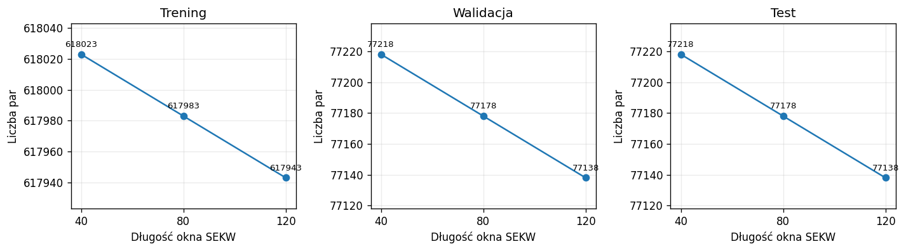
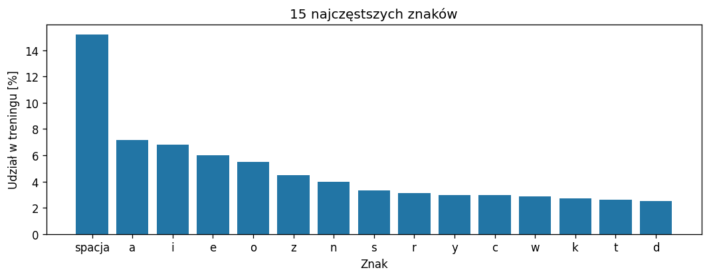
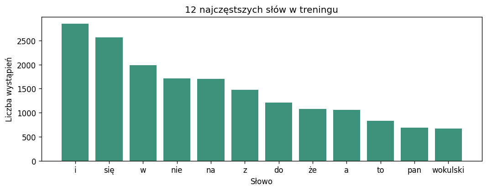

# Sprawozdanie laboratoryjne

**Przedmiot:** Uczenie głębokie w systemach rozpoznawania i przetwarzania mowy  
**Zajęcia nr / temat:** 6 — Projekt generacyjny, część 1: przygotowanie danych dla Char-RNN  
**Autor / grupa:** Oskar Pietrzak / 03  
**Data:** 25.11.2026

## 1. Cel ćwiczenia

Celem było przygotowanie polskiego korpusu do przewidywania następnego znaku: oczyszczenie tekstu, utworzenie rozłącznych zbiorów, zbudowanie słownika na treningu oraz przygotowanie i sprawdzenie par wejście–cel. Zbadano też wpływ długości okna na liczbę przykładów. Dane zapisano do wykorzystania przy treningu Char-RNN na laboratorium 7.

## 2. Metoda i implementacja

### Korpus i warunki użycia

Wykorzystano I tom „Lalki” Bolesława Prusa z serwisu [Wolne Lektury](https://wolnelektury.pl/katalog/lektura/lalka-tom-pierwszy/), pobrany jako [plik TXT](https://wolnelektury.pl/media/book/txt/lalka-tom-pierwszy.txt). Jest to polska powieść realistyczna, zawierająca narrację, dialogi, opisy i pamiętnik Rzeckiego. Duża objętość oraz zróżnicowanie składni i interpunkcji uzasadniają wybór do ćwiczenia znakowego modelu języka.

Nota wydawnicza pliku wskazuje, że utwór jest w domenie publicznej, a materiały dodatkowe, w tym przypisy i motywy, są objęte Licencją Wolnej Sztuki 1.3. Wykorzystano tekst powieści bez nagłówka wydawniczego i stopki. Zachowano oryginalny plik oraz informację o źródle i opracowaniu. Uwzględniono [zasady wykorzystania Wolnych Lektur](https://wolnelektury.pl/info/zasady-wykorzystania/).

Jako alternatywny gotowy zbiór sprawdzono [wikimedia/wikipedia w Hugging Face Datasets](https://huggingface.co/datasets/wikimedia/wikipedia), obejmujący artykuły Wikipedii w wielu językach. Karta zbioru wymienia CC BY-SA 3.0 i GFDL; wykorzystanie wymaga uwzględnienia atrybucji i warunków odpowiedniej licencji. W ćwiczeniu wybrano powieść, aby zachować spójny styl i prosty podział jednego dokumentu.

### Przygotowanie i podział

Odczytano plik w UTF-8, zastosowano normalizację Unicode NFC i ujednolicono końce linii do `\n`. Usunięto nagłówek z metadanymi i stopkę serwisu, zamieniono twarde spacje na zwykłe, zredukowano nadmiarowe spacje oraz puste linie. Zachowano polskie litery, wielkość liter, interpunkcję, nagłówki rozdziałów i granice akapitów. Sprawdzono początek, środek i koniec tekstu oraz brak znaczników HTML. Korpusu nie powielano.

Oczyszczony tekst zawiera **772579 znaków** i jest jednym dokumentem. Podzielono go na ciągłe fragmenty **80% / 10% / 10%**, a dopiero potem utworzono okna. Większa część treningowa zapewnia wiele przykładów, a każda pozostała część ma ponad 77 tys. znaków. Granice, liczone od zera z wyłącznym końcem, wynoszą:

- trening: `[0, 618063)`,
- walidacja: `[618063, 695321)`,
- test: `[695321, 772579)`.

Żadne okno nie przekracza granic podziału. Granica może wypaść wewnątrz słowa; dla zadania znakowego nie wymaga to uzupełniania tekstu ani przenoszenia znaków między zbiorami.

Fragment po oczyszczeniu:

```text
I. Jak wygląda firma J. Mincel i S. Wokulski przez szkło butelek?

W początkach roku 1878, kiedy świat polityczny zajmował się pokojem san-stefańskim, wyborem nowego papieża albo szansami europejskiej wojny, warszawscy kupcy tudzież inteligencja pewnej okolicy Krakowskiego Przedmieścia niemniej gorąco interesowała się przyszłością galanteryjnego sklepu pod f
```

### Narzędzia i konfiguracja

Użyto Python, PyTorch, NumPy, pandas i Matplotlib. W wykonanym notebooku: PyTorch `2.15.0+cpu`, NumPy `2.3.5`. [Notebook z rozwiązaniem](laboratorium_06_grupa_03.ipynb) zawiera wykonane komórki i wyniki.

Słownik powstał wyłącznie z posortowanych znaków treningowych. Zawiera **101 znaków korpusu oraz zarezerwowany symbol UNK `�` o ID 0**, łącznie **V=102**. Ten sam słownik stosowano do wszystkich zbiorów. Nieznany znak zostałby zamieniony na UNK.

Ustawiono `SEKW=40`, `batch_size=32`, krok okna równy 1 i ziarno 0. Trening ma `shuffle=True` i `drop_last=True`, natomiast walidacja oraz test mają oba ustawienia równe `False`. Liczba par dla fragmentu długości N wynosi `max(0, N - SEKW)`. Najważniejsza operacja w Dataset:

```python
x = self.dane[i:i+self.sekw]
y = self.dane[i+1:i+self.sekw+1]
```

## 3. Wyniki

### Podział i liczebności

| Zbiór | Znaki | Udział | Różne znaki | Pary (SEKW=40) | Batche |
| --- | --- | --- | --- | --- | --- |
| Trening | 618063 | 80.00% | 101 | 618023 | 19313 |
| Walidacja | 77258 | 10.00% | 74 | 77218 | 2414 |
| Test | 77258 | 10.00% | 81 | 77218 | 2414 |

Udziały procentowe zaokrąglono do dwóch miejsc. Trening wykorzystuje w pełnych batchach **618016 par**; ostatnie **7 par** jest pomijanych przez `drop_last=True`. Walidacja i test obejmują wszystkie **77218 par** każdy, z ostatnim batchem o kształcie **[2, 40]**.

### Kontrola kodowania i batchy

Test `dec(enc(fragment)) == fragment` dla pierwszych 300 znaków treningu zwrócił **True**. Dodatkowo sprawdzono pełne odtworzenie każdej części: **trening=True, walidacja=True, test=True**. Liczba wystąpień znaków spoza słownika wyniosła odpowiednio **0, 0, 0**; rezerwa UNK nie została użyta.

Sprawdzono pierwszy batch z każdego loadera:

| Zbiór | Kształt X i Y | Typ | Zakres ID w batchu | Kontrole |
| --- | --- | --- | --- | --- |
| Trening | [32, 40] | torch.int64 | 1–101 | OK |
| Walidacja | [32, 40] | torch.int64 | 1–101 | OK |
| Test | [32, 40] | torch.int64 | 2–96 | OK |

Wszystkie ID mieszczą się w dozwolonym zakresie **0–101**. Potwierdzono zgodność kształtów i typów, równość `X[:, 1:] == Y[:, :-1]` oraz zgodność jednej odkodowanej pary z tekstem źródłowym, włącznie z ostatnim znakiem celu. Przykłady zapisano przez `repr()`, aby uwidocznić spacje i znaki nowej linii:

**Trening — indeks lokalny 140623:**

```text
X = ' panna Izabela tak osłabła, że nogi zach'
Y = 'panna Izabela tak osłabła, że nogi zachw'
Ostatni znak Y = 'w'
```
**Walidacja — indeks lokalny 0:**

```text
X = 'ienicę… kamienicę pana Łęckiego?…\n\n— Nic'
Y = 'enicę… kamienicę pana Łęckiego?…\n\n— Nic '
Ostatni znak Y = ' '
```
**Test — indeks lokalny 0:**

```text
X = ' pannie Izabeli Starski jako mąż, Rossi '
Y = 'pannie Izabeli Starski jako mąż, Rossi j'
Ostatni znak Y = 'j'
```

### Wpływ długości okna

Tekst, granice podziału i krok 1 pozostawały identyczne we wszystkich porównaniach.

| SEKW | Trening | Walidacja | Test |
| --- | --- | --- | --- |
| 40 | 618023 | 77218 | 77218 |
| 80 | 617983 | 77178 | 77178 |
| 120 | 617943 | 77138 | 77138 |



Każdy panel ma własną skalę osi Y, aby pokazać niewielkie różnice liczebności. Dla odniesienia użyto okna 40 znaków, zgodnego z notebookiem ćwiczeniowym; porównano je z oknami 80 i 120 znaków.

### Najczęstsze znaki i słowa

| Znak | Wystąpienia | Udział w treningu |
| --- | --- | --- |
| spacja | 93886 | 15.190% |
| a | 44128 | 7.140% |
| i | 42206 | 6.829% |
| e | 37051 | 5.995% |
| o | 34043 | 5.508% |
| z | 27753 | 4.490% |
| n | 24706 | 3.997% |
| s | 20501 | 3.317% |



Dodatkowo wykonano analizę 12 najczęstszych słów. Słowa wyodrębniono wyrażeniem `[^\W\d_]+`, po zamianie liter na małe, bez usuwania słów funkcyjnych.



Najczęściej występują: „i” — 2848, „się” — 2560, „w” — 1984, „nie” — 1712 oraz „na” — 1698. W pierwszej dwunastce znajdują się również „pan” — 691 i „wokulski” — 670.

## 4. Analiza i interpretacja

Najczęstszym znakiem jest spacja, obejmująca około **15,19%** treningu. Wśród liter przeważają „a”, „i”, „e” i „o”. Model będzie często widział separatory oraz popularne litery, a znacznie rzadziej znaki obce i nietypową interpunkcję. Poprawne kodowanie nie oznacza zatem, że wszystkie znaki będą równie dobrze przewidywane.

Wydłużenie okna z 40 do 120 znaków zmniejszyło liczbę par o **80 w każdym zbiorze**: o około **0,013%** w treningu i **0,104%** w walidacji oraz teście. Zależność jest liniowa i wynika z konieczności zachowania dodatkowego znaku celu. Dłuższe okno daje więcej kontekstu, ale zwiększa długość przetwarzanej sekwencji i koszt przyszłego treningu. Liczba przykładów zmienia się tu nieznacznie, ponieważ korpus jest znacznie dłuższy niż okna.

Dominacja krótkich słów funkcyjnych jest zgodna z ich częstym użyciem w języku. Obecność nazwiska Wokulskiego pokazuje zależność rozkładu od treści powieści. Ograniczeniem jest jeden autor i historyczna polszczyzna; przygotowane dane nie reprezentują całej współczesnej komunikacji. Rozłączne fragmenty zapobiegają współdzieleniu tych samych pozycji tekstu przez okna różnych zbiorów, lecz zachowują wspólny styl i bohaterów. Wynik na teście będzie dotyczył tego korpusu.

Nie trenowano jeszcze sieci, więc na tym etapie nie wyznaczano accuracy, straty ani perplexity. Oceniano poprawność przygotowania danych.

## 5. Wnioski

Przygotowano odtwarzalny potok danych dla Char-RNN. Wszystkie zbiory korzystają z jednego słownika treningowego, poprawnie odtwarzają tekst i dostarczają pary z celem przesuniętym o jeden znak. Przeprowadzone kontrole obejmują również ostatni znak celu, którego nie sprawdza sama równość wspólnej części okien.

Do kolejnego laboratorium zachowano źródło, oczyszczony korpus, trzy fragmenty tekstowe, słownik, tablice ID, granice podziału, konfigurację i statystyki w katalogu `dane_lab_06`. Integralność źródła kontroluje SHA-256, a granice podziału pozostają stałe dla dalszych eksperymentów. Kolejny etap to trening Char-RNN i obserwacja straty na treningu oraz walidacji; test należy zachować do końcowej oceny.

---

Prowadzący: dr Tomasz Cieplak / mgr inż. Patryk Marek, rok akademicki 2026/27.
